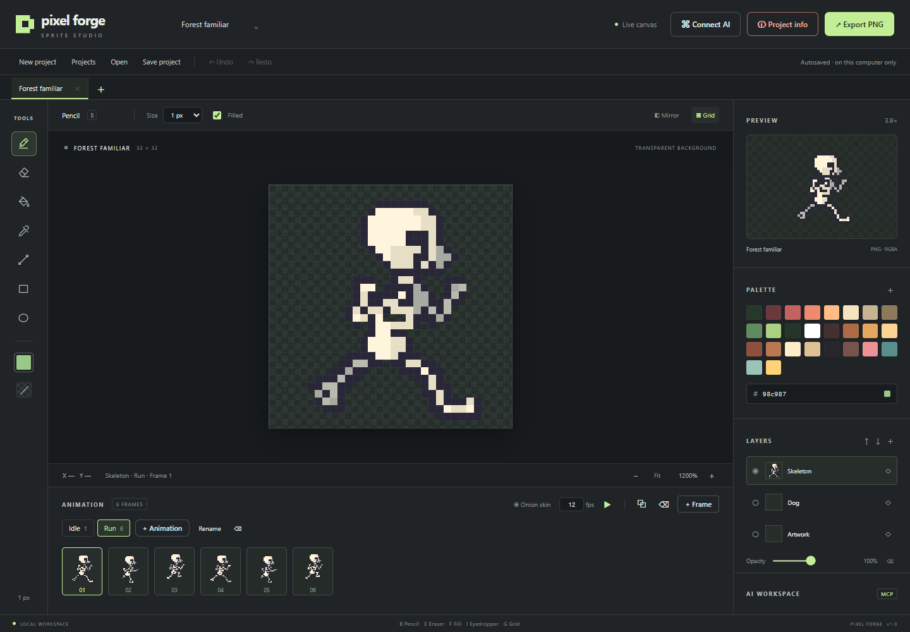

# Pixel Forge

A local pixel art editor for game development. Draw by hand while Codex or Claude Code edits **the same canvas** through MCP, with changes visible in real time. Built with JavaScript, Node.js, and HTML Canvas, with no build step or API key required in the editor.



English is the default language for the interface, built-in messages, documentation, and MCP activity labels. Project and layer names entered by users are preserved as written.

## Beginner quick start: your first AI drawing

You will use two apps together: **Pixel Forge** is where you see and edit the drawing, and **Codex** is where you tell the AI what to draw. MCP is the connection that lets Codex change the canvas. Keep both apps running while you draw.

### Step 1: open Pixel Forge

1. If you downloaded `Pixel-Forge.zip`, right-click it in Windows File Explorer and choose **Extract All**. Open the extracted folder. Run the application from that folder, rather than from inside the ZIP.
2. Install **Node.js 20 or later** from [nodejs.org](https://nodejs.org/) if it is not already installed. After installing it, close any old terminal windows before continuing.
3. Double-click **START.cmd** in the project folder. On the first run, it downloads the required dependencies, so wait for it to finish. Internet access is needed for that first installation.
4. Your browser should open Pixel Forge. If it does not, open **http://127.0.0.1:3210/** yourself.
5. Leave the server window open. The editor should show **Live canvas** near the top. Seeing only the browser tab is not enough if the server has stopped.

### Step 2: ask Codex to set up the connection once

Open Codex on the **same computer** as Pixel Forge. Paste this into a Codex chat:

> Set up the connection to my local Pixel Forge editor. It is already running at http://127.0.0.1:3210/. Register an MCP server named pixel-forge with the Streamable HTTP endpoint http://127.0.0.1:3210/mcp. Make the configuration change and verify that the server is registered. Preserve my other MCP settings. Do not draw yet. Tell me when I need to restart Codex.

This setup only needs to be done once on each computer. Opening the editor in Codex's browser does not automatically register the MCP server.

If you prefer to set it up yourself, open **PowerShell** from the Windows Start menu, paste this command, and press Enter:

```powershell
codex mcp add pixel-forge --url http://127.0.0.1:3210/mcp
```

If Windows says that `codex` is not recognized, use Codex's **Settings → MCP servers → Add server** instead. Enter `pixel-forge` as the name, choose **Streamable HTTP**, and enter `http://127.0.0.1:3210/mcp` as the URL. Save the configuration.

### Step 3: restart Codex and open a new chat

Close and reopen Codex after registering the server, then open a **new chat**. Leave Pixel Forge's server running throughout this step. The new chat needs access to the newly configured MCP tools.

### Step 4: tell Codex what to draw

Copy this into the new Codex chat:

> Use the pixel-forge MCP server. First call pixel_get_project and inspect the canvas with pixel_get_preview. Start a new project named "Cat companion" for a new character, using a 32 by 32 pixel canvas. Read the new project IDs, then draw a cute pixel art cat in its default Idle animation with a transparent background. Keep the previous character saved in Projects. Draw in several separate MCP calls so I can watch the progress live in the editor. Use English activity labels. When finished, inspect the result with pixel_get_preview. If the MCP tools are unavailable, tell me before proceeding.

You can replace "cat" and "Cat" with "dog" and "Dog", or describe another character, item, or prop. You can write your own requests in your preferred language; English remains the editor's default language.

Watch **http://127.0.0.1:3210/** while Codex works. The sprite should appear on the canvas in stages. The **AI WORKSPACE** panel should show MCP activity, and the timeline should show **Idle**. Your previous character remains available under **Projects**.

### Step 5: request changes in the same chat

Continue talking to Codex while keeping the editor open. For example:

> Use pixel-forge MCP to give the cat blue eyes and a red collar. Keep the rest of the sprite unchanged.

For an animation, try:

> Use pixel-forge MCP to duplicate the current frame three times and create a four-frame tail-wagging animation at 8 fps. Preserve the existing layers. Inspect the frames when finished.

Click **Play** (the triangle button) to preview the selected animation group. For a separate action of the same character, ask: "Add a Run animation group to this character project and animate it running. Keep Idle unchanged." Click **Undo** to undo a recent edit.

### Step 6: save your work

- Click **Save project** to download a `.pixel.json` file containing every layer, frame, and the palette. Keep this file if you want to continue editing later.
- Click **Export PNG**, choose **PNG · selected frame**, keep **1× · original pixels** for a game asset, and click **Download file**.
- For an animation, select the group in the export dialog and choose **PNG · animation sprite sheet**. Export **JSON · sprite sheet metadata** separately if your game needs frame positions and timing. Use the same group and scale for the PNG and JSON. For a project named Forest familiar and group Idle, downloads are named `forest-familiar-idle.png` and `forest-familiar-idle.json`.

### Next time you want to draw

1. Double-click **START.cmd** and leave the server running.
2. Open Codex. You do not need to register the same MCP server again.
3. Open a new chat and paste a drawing request like the one in Step 4.
4. Watch the editor, request changes, and save your project when finished.

### If something does not work

| What you see                                                | What to do                                                                                                                                                                                      |
| ----------------------------------------------------------- | ----------------------------------------------------------------------------------------------------------------------------------------------------------------------------------------------- |
| The browser cannot open the editor, or it says Reconnecting | Run `START.cmd` and keep its server window open. Then refresh the browser.                                                                                                                      |
| The launcher asks for Node.js                               | Install Node.js 20 or later, then close and reopen the launcher.                                                                                                                                |
| Codex says the MCP tools are unavailable                    | Check the server registration from Step 2, restart Codex, and open a new chat. Keep the editor running. You can check registration with `codex mcp list` in PowerShell if the CLI is available. |
| Codex only creates a PNG file in the chat                   | Tell it: "Draw inside the existing Pixel Forge canvas using the pixel-forge MCP tools. I want to see live edits in the editor."                                                                 |
| The new drawing is hidden behind old artwork                | For a new character, ask Codex to create a new project. For the same character, select the desired animation and check layer visibility.                                                        |
| You accidentally changed the wrong thing                    | Click Undo. For a previous session, reopen a project copy you downloaded with Save project.                                                                                                     |

The editor does not need an OpenAI API key. You use the model through your existing Codex or Claude Code client.

## Project tabs

Each project has its own tab below the menu bar. **New project**, the **+** button beside the tabs, PNG imports, and MCP `new_project` open a new tab and leave earlier projects available. Opening an existing `.pixel.json` uses its project ID: it selects that project's tab instead of creating a duplicate.

- Click a tab to return to its saved artwork, selected animation, and frame. Renaming a project updates its tab name.
- Click a tab's **×** to close it. The project remains saved and can be reopened through **Projects**. Closing the active tab selects a neighboring project; at least one tab stays open.
- Open-tab order and the selected project survive browser reloads and server restarts. Tabs scroll horizontally when there are more than fit. With a tab focused, use Left/Right arrows, Home, or End to select another project.
- Undo/Redo belongs to each project and remains available when switching tabs during the current server session. Switching tabs and opening an empty new project do not create drawing undo steps. If an MCP batch creates a new project and draws in it, Undo removes that batch's drawing inside the new tab.

The selected project is shared across all editor windows and MCP clients. Selecting a tab changes the shared live canvas. MCP edits with an outdated project ID are rejected so they cannot paint into a different character.

## Animation groups: Idle, Run, Attack

Each project is one character or game asset. Its first animation is always **Idle**. Existing project files and autosaves automatically become one Idle group with their pixels, layers, and frame IDs preserved.

1. Under **ANIMATION**, click **+ Animation**, enter a name such as **Run**, and confirm. The new group starts with one blank frame.
2. Click a group tab to switch between its frames. **+ Frame**, duplicate frame, playback, onion skin, and FPS apply to the selected group. Groups share the project's layers and palette, while every frame has its own pixels.
3. Click **Rename** to change the selected group's name, including Idle. Use the animation delete button to remove a group and its frames; at least one group and one frame per group must remain. These edits support Undo/Redo.
4. Click **Export PNG**, choose the animation, format, and scale, then download. Sprite sheets contain only that group's frames. PNG and metadata use the same project-animation basename, such as `forest-familiar-idle`. **Save project** downloads the complete editable project, including all groups.

Animation names must produce distinct filenames, so **Run** and **run!** cannot coexist. If automatic Unity/Unreal export is enabled, it still exports one selected frame at a time, now under the filename prefix plus animation name. It does not export a whole sheet automatically or create engine animation clips.

For a new character, ask MCP to create a **new project**. For a new action or pose of the current character, ask it to keep the project and create or edit an animation group. **Projects** reopens characters saved on this computer; **Open** imports a PNG or portable `.pixel.json` file.

## Project info: engine and export folder

Click **Project info** in the top bar to edit the project name, see its canvas dimensions, and choose where its PNG should be saved.

1. Under **Game engine**, choose **Unity** or **Unreal Engine**.
2. Check **Automatically export PNG to this folder**.
3. Click **Browse…** to choose a folder on Windows, or paste the full path into **Export folder**. For Unity, choose a folder inside the project's `Assets` directory. For Unreal, choose the PNG source folder you want the engine to monitor.
4. Enter a **Filename prefix (animation name is added)** such as `forest-familiar`. Idle then exports as `forest-familiar-idle.png`, and Run as `forest-familiar-run.png`.
5. Click **Save project info**.

To reuse the destination, check **Use this as the main export folder for all projects** before saving. Pixel Forge remembers the main folder after restarting. The engine, folder, Unity pixels-per-unit setting, and importer option are shared; each project keeps its own PNG filename and automatic export setting. Setting the main folder for the first time makes existing projects use it too. Later main-folder changes apply to projects that use it.

New projects inherit the main destination and receive a filename prefix based on their project name. Automatic export starts **off** for each new project: open **Project info**, review its filename, check **Automatically export PNG to this folder**, and save. Your existing projects keep their automatic export setting.

For a separate destination, uncheck **Use this as the main export folder for all projects**, choose the folder for this project, and save. This project then keeps its own destination when the main folder changes. Opening a saved `.pixel.json` restores the project's local settings by project ID. Settings stay on this computer; choose a destination again on another computer. Existing export settings migrate automatically without enabling the new checkbox.

**Browse…** opens a Windows folder chooser only when you click it. You can create a folder there or cancel without changing the destination. Other platforms can use the path field directly.

### Unreal Engine setup

Pixel Forge writes standard PNG source images. Unreal imports these into its own assets; Pixel Forge does not generate `.uasset` files or install a Unity importer when Unreal is selected.

1. In **Project info**, select **Unreal Engine**, choose a source folder such as `YourProject/Content/Sprites`, enter the filename, enable automatic export, and save.
2. In Unreal, import the PNG once into the desired Content Browser folder.
3. Open **Editor Preferences → Loading & Saving → Auto Reimport** and enable **Monitor Content Directories**. Add your PNG source folder to **Directories to Monitor** if it is not already monitored. You can limit the include wildcard to `*.png`.
4. Keep that PNG as the imported texture's source file. Later changes from Pixel Forge can then be reimported automatically by Unreal. For automatic creation of new assets from a custom source folder, Unreal also needs an appropriate mount point and **Auto Create Assets** enabled.
5. For a 2D sprite, enable Unreal's **Paper 2D** plugin if needed, apply **Paper 2D Texture Settings** to the imported texture, and create a Sprite from it in Unreal.

Saving a PNG and creating a Paper 2D Sprite are separate steps. Automatic reimport requires the Unreal editor's monitoring settings; selecting Unreal in Pixel Forge does not change those settings for you.

Official Unreal references: [Auto Reimport](https://dev.epicgames.com/documentation/en-us/unreal-engine/reimporting-assets-automatically-in-unreal-engine), [Paper 2D sprite import](https://dev.epicgames.com/documentation/en-us/unreal-engine/how-to-import-and-use-paper-2d-sprites-in-unreal-engine).

### Send sprites to Unity automatically

You can connect Pixel Forge directly to an existing folder inside your Unity project's `Assets` directory. Once configured, manual strokes and MCP edits automatically update a PNG in that folder. You do not need to download and copy the PNG after each change.

#### First-time Unity setup

1. Open Pixel Forge and choose **Project info** in the top bar. Select **Unity** under **Game engine**.
2. Check **Automatically export PNG to this folder**.
3. Click **Browse…** or paste the full path to an existing sprite folder, for example:

   ```text
   C:\Users\Tomislav\Documents\Unity Projects\TestClaude\Assets\Sprites
   ```

4. Set **Filename prefix (animation name is added)** to a short asset name such as `dog`. Use letters, numbers, underscores, or hyphens. With Idle selected, this creates `dog-idle.png`. The project name is suggested for new destinations.
5. Choose **Pixels per Unity unit**. The default is `32`, which makes a 32-pixel-wide sprite one Unity world unit wide. Use your game's existing pixels-per-unit value if it is different.
6. Leave **Install the Unity pixel art importer** checked and click **Save project info**.
7. Open the Unity project or switch to its window once. Allow it to import and compile the new editor script. If necessary, choose **Assets → Refresh**. The initial compilation must finish before the live importer can run.
8. In Unity's Project window, open `Assets/Sprites`. The new PNG should be imported as **Sprite (2D and UI)** with **Point** filtering, no compression, no mipmaps, and your selected pixels-per-unit value.
9. Drag the sprite from Unity's Project window into your scene. Continue drawing in Pixel Forge; the same image file will update automatically after each completed change.

For Codex, you can now say:

> Use pixel-forge MCP to adjust the current sprite. Automatic Unity export is already enabled in Project info, so keep the current project and update the canvas. The PNG will be exported automatically. Keep the configured filename.

#### What sync does

- It exports the **currently selected frame**, with all visible layers composited onto a transparent background, at the original 1× pixel size. Hidden layers are excluded. White pixels you paint remain white pixels.
- It waits briefly after changes so a burst of edits does not trigger a separate disk write for every command. Unchanged PNG contents are not rewritten.
- It updates the same PNG within an animation group. Switching groups changes the suffix, such as `dog-idle.png` or `dog-run.png`. Renaming a group creates a new filename; earlier exports remain on disk. For a new character or separate asset, create a new project.
- Selecting another frame within a group updates that group's PNG. This feature exports one frame at a time; it does not create Unity animation clips or automatically slice sprite sheets. For a full animation sheet, use **Export PNG** and the separate JSON metadata export.
- It creates a small matching file such as `dog-idle.pixelforge.json` with import settings, plus `Editor/PixelForgeSpriteImporter.cs` inside the selected folder when importer installation is enabled.
- The Unity editor script only applies import settings to PNGs with a valid Pixel Forge sidecar. It checks for changes once per second while Unity runs, then requests an asset import. Other artwork is left alone, and existing `.meta` files are preserved so Unity asset references keep their GUIDs.
- If a PNG with the chosen name already exists without a Pixel Forge sidecar, or belongs to another Pixel Forge project, sync refuses to overwrite it. Choose a fresh filename.
- The main destination and per-project overrides are saved locally in `data/unity-sync.json`. They are separate from your `.pixel.json` project file and are not included in the downloadable source ZIP.

To stop exporting, open **Project info**, uncheck **Automatically export PNG to this folder**, and save. Existing files remain in Unity. New projects start with automatic export off; reopening a project restores its own saved local destination. For a different character, create a new project. New exports include an animation suffix; older exports such as `dog.png` remain untouched, so use the new `dog-idle.png` asset in your game if you are upgrading.

#### If Unity does not show the latest image

1. Check **Project info** in Pixel Forge. It should say **Synced:** and show the expected output path. An error is also shown there if the folder becomes unavailable or a write fails.
2. Keep the Pixel Forge server running. Unity does not need to stay open for PNG exports; it will import them when you next open the project.
3. After first installing the importer, switch to Unity and wait for script compilation. Use **Assets → Refresh** if required. Fix any unrelated Unity compilation errors before expecting the importer to run.
4. If you chose not to install the importer, use Unity's normal asset refresh and set Sprite/Point/no compression yourself in the Inspector.
5. Ensure you are viewing the exported filename and the correct frame, and that the desired layer is visible in Pixel Forge.

Unity references: [Asset refresh](https://docs.unity.com/en-us/engine/6000.0/manual/assets-and-media/asset-database/refreshing), [TextureImporter settings](https://docs.unity.com/en-us/engine/6000.5/script-reference/unityeditor/textureimporter).

## Running from a terminal and other launch options

`START.cmd` installs dependencies on the first run and opens the editor. If an editor is already running on the selected port, it opens that instance. Press Ctrl+C in the server window to stop a server you started there.

The previous `POKRENI.cmd` launcher remains available as a compatibility alias for `START.cmd`.

Alternatively, run these commands in this directory:

```powershell
npm ci
npm start
```

The interface runs locally in your browser. This version does not include a standalone `.exe` installer.

## Connect an AI client

Keep the editor running. Its MCP endpoint is **http://127.0.0.1:3210/mcp**, using **Streamable HTTP**. The **Connect AI** button in the editor also shows these commands with copy buttons.

Codex:

```powershell
codex mcp add pixel-forge --url http://127.0.0.1:3210/mcp
```

Alternatively, add this entry to Codex's `config.toml`:

```toml
[mcp_servers.pixel-forge]
url = "http://127.0.0.1:3210/mcp"
```

Claude Code:

```powershell
claude mcp add --transport http pixel-forge http://127.0.0.1:3210/mcp
```

Restart your client or refresh its MCP connection after adding the server. Check `codex mcp list` or `claude mcp list`. You can also add a Streamable HTTP server with the same URL in Codex's settings. If the tools are unavailable in an existing chat, restart the client and open a new chat.

Example prompt:

> Use pixel-forge MCP. Read the existing project first. Create a new project named "Dog companion" for a new character, at 32 by 32 pixels. Read the new IDs, then draw a pixel art dog with a transparent background in Idle. Draw in several smaller steps so I can watch in real time. Keep the previous character saved under Projects. Inspect the result with pixel_get_preview when finished.

For animation:

> Keep this character project. Add a Run animation group, duplicate the current pose into it, and create four running frames at 12 fps. Keep Idle unchanged. Export only Run as a sprite sheet when finished.

**The model and conversation run in Codex or Claude Code.** The editor itself does not send prompts to a model. Installing this project does not automatically register its MCP server in your clients.

Official documentation: [OpenAI MCP setup](https://learn.chatgpt.com/docs/extend/mcp), [Claude Code MCP](https://code.claude.com/docs/en/mcp), [MCP TypeScript SDK](https://ts.sdk.modelcontextprotocol.io/server).

## Features

- Pencil and eraser with 1–8 px brushes; right-click to erase and Alt+click to pick a color.
- Eyedropper, flood fill, line, rectangle, and ellipse; shapes support filled or outlined drawing.
- Custom RGBA hex colors, editable palette, and transparent drawing.
- Horizontal symmetry for pencil and eraser strokes, a pixel grid, and nearest-neighbor zoom.
- Layers with visibility, locking, opacity, and ordering. Double-click a layer name to rename it.
- Animation frames, duplication, playback at 1–60 fps, and onion skin for the previous frame.
- Per-project Undo/Redo for manual strokes and AI edits, retained when switching tabs during the server session.
- Persistent project tabs and named animation groups (Idle, Run, Attack), with separate frames and FPS, plus a local Projects library for saved characters.
- PNG export with a real alpha channel, for a single frame or a horizontal sprite sheet, at 1×–16× scale.
- Sprite sheet JSON metadata with frame coordinates and timing, downloaded separately. JSON metadata downloaded from the interface describes the sheet at its original **1×** size.
- PNG and `.pixel.json` project import. Project files preserve all frames, layers, and the palette.
- Automatic saving to disk, with multiple windows following the same project live.
- Activity history identifies manual edits and MCP commands. Demonstration commands are labeled Demo.
- A persistent main Unity or Unreal export folder, per-project overrides, a Browse button on Windows, and an optional Unity pixel art importer.

## Keyboard shortcuts

| Key                             | Action                              |
| ------------------------------- | ----------------------------------- |
| B / E / F / I                   | Pencil / eraser / fill / eyedropper |
| L / R / O                       | Line / rectangle / ellipse          |
| G                               | Toggle grid                         |
| Space                           | Play/pause animation                |
| Ctrl+Z / Ctrl+Shift+Z or Ctrl+Y | Undo / redo                         |
| Ctrl+S                          | Download project                    |
| + / − / 0                       | Zoom in / zoom out / fit canvas     |
| Ctrl+mouse wheel                | Zoom                                |
| Esc                             | Cancel the current stroke           |

## Saving and limits

The autosave file is `data/autosave.pixel.json`, relative to this directory. Each project is also saved in `data/projects/`; use **Projects** to reopen a previous character. Switching projects saves the previous project before activating the next, and the library remains available after a restart. Saving writes a temporary file before replacing the autosave. If an existing autosave is invalid, the server will refuse to overwrite it silently: keep the file for recovery, move it out of `data/`, and restart the editor.

**Save project** downloads a separate copy. Undo/Redo for each project and the shared activity log are held in memory until the server restarts; artwork and open tabs stay on disk. `data/workspace.json` stores open project IDs in tab order, while the autosave identifies the active project. All MCP clients and browser windows share the selected project. If two clients change the same pixel, the last received command wins. Client instructions recommend explicit project, frame, and layer IDs to keep edits targeted correctly.

Canvas dimensions are 1–256 px per axis, with up to 16 layers, 32 animation groups, 64 frames total across all groups, and 1,048,576 total pixels across all frames and layers. History is capped at 60 steps and has a memory limit. PNG exports are limited to 16 megapixels. PNG import does not automatically resize large images.

This is a functional first version. Advanced selections, a tilemap editor, GIF/Aseprite formats, and a desktop installer are not included.

The server listens only on `127.0.0.1`, rejects foreign Origin/Host headers, and serves interface files from `public/` and pure drawing geometry from `shared/`. Local processes with access to the endpoint can edit the canvas and configure project export settings. Automatic export can write its PNG and sidecar into the folder you select, plus an optional editor importer for Unity destinations. It is intended for personal local use; remote authentication and public hosting are not implemented.

## Real MCP demo

In a second terminal, with the editor running:

```powershell
npm run demo -- --replace
```

This opens a new project tab with a mushroom example and draws it through several separate MCP calls. Return to the previous project by selecting its tab. **It is a deterministic demonstration client**, without a model, using the same MCP protocol as AI clients. Without `--replace`, it does not change the canvas. You can also open the included `examples/forest-familiar.pixel.json` project in the editor.

## Development and verification

```powershell
npm test
npm run test:browser
npm run format
```

The browser test uses an installed **Google Chrome** through Playwright. Alternatively, set `$env:PW_BROWSER="msedge"` to use Edge. The test starts its own temporary server with an in-memory project and leaves your autosave untouched.

`npm test` checks rasterization, transactions, Undo/Redo, layers, frames, persistence, PNG output, and real MCP HTTP/SSE integration. The browser test draws with the mouse and checks two live windows, MCP edits, animation, downloads, and PNG/project import round trips.

Project structure (see [ARCHITECTURE.md](ARCHITECTURE.md) for drawing flow and extension points):

```text
public/app.js        application wiring, selection, and server connection
public/tools/        one file per drawing tool with preview and operation behavior
public/editor/       canvas rendering, pointer input, and stroke lifecycle
public/ui/           layers, palette, timeline, files, and Project info panels
shared/              pure geometry, animation selection, and export filenames
src/project/         schemas, animation operations, and saved project library
src/model.js         project creation, structural changes, and compositing
src/drawing/tools/   one handler per drawing operation
src/store.js         transactions, history, and autosave
src/mcp/tools/       one registration file per MCP tool
src/mcp.js           MCP setup and common error handling
src/server.js        local HTTP routes, MCP transport, and SSE
src/png.js           PNG export and sprite sheet metadata
src/export/          destination profiles, sync scheduling, PNG writer, importer
src/fs/              atomic file writes
src/unity-sync.js    compatibility exports for earlier integrations
src/folder-picker.js Windows folder chooser used by Project info
unity/Editor/        Unity importer source, installed through Project info
scripts/             launcher and real MCP demonstration client
test/                model, integration, and browser checks
```

For another port, run `$env:PORT="3211"; npm start` and update the MCP endpoint accordingly. To run the demo against another port, set `$env:PIXEL_FORGE_URL="http://127.0.0.1:3211/mcp"`.

## MCP tools

| Tool                 | Purpose                                                       |
| -------------------- | ------------------------------------------------------------- |
| `pixel_get_project`  | Dimensions, palette, frame/layer IDs, selection, and revision |
| `pixel_get_pixels`   | Exact layer pixels in a region up to 64 × 64                  |
| `pixel_get_preview`  | PNG preview of the visible layers                             |
| `pixel_draw`         | Atomic batch of drawing and project changes                   |
| `pixel_paint_sprite` | Precise sprites from symbol rows and a color map              |
| `pixel_history`      | Undo/Redo for the shared history                              |
| `pixel_export`       | PNG image and matching frame metadata                         |

See [MCP-GUIDE.md](MCP-GUIDE.md) for details and examples.
